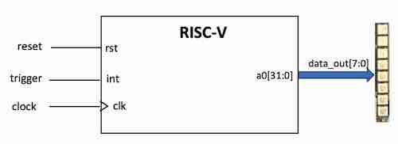
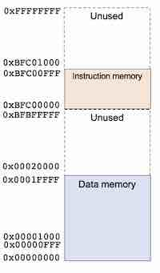
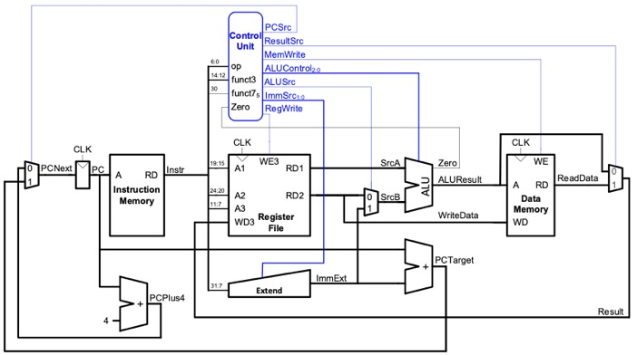
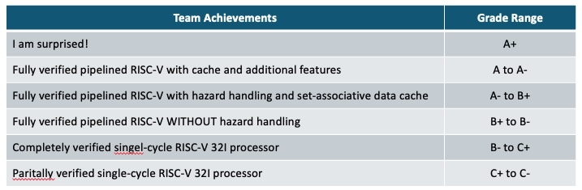
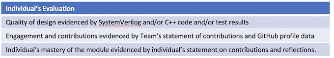

## EIE2 Instruction Set Architecture & Compiler (IAC)

---
## Team Project - RISC-V RV32I Processor

**_Peter Cheung, V2.4 - 17 Nov 2026_**

---

## Objectives

* To learn RISC-V 32-bit integer instruction set architecture
* To implement a single-cycle RV32I instruction set in a microarchitecture
* To implement the F1 starting light algorithm in RV32I assembly language
* To verify your RV32I design
* To implement a simple pipelined version of the microarchitecture with hazard detection and mitigation
* As a stretched goal, add set-associative data cache to the pipelined RV32I
* As a further streched goal complete RV32I processor (or any extensions)

 

___

## Learning the RV32I Instruction Set
___

Before you start the hardware design, every team member should learn the RV32I in some detail by jointly creating your team's assembly language program to implement the F1 starting light algorithm from Lab 3 in RV32I instructions.

[This document](https://riscv.org/wp-content/uploads/2017/05/riscv-spec-v2.2.pdf) is v2.2 of the official RISC-V instruction set manual. You do not need to implement all of the instructions in it! The RV32I instructions are described in detail in section 2 (page 9). The table on page 104 is very useful for checking instruction encodings. For the minimum attainment, you are only required to implement the instructions in the PDF reference program (although you can implement more as a stretched goal)!

Your CPU will be tested using your team's F1 program, the PDF reference program in `tb/reference`, and the verification tests in `tb/asm`. Your F1 program **MUST** use at least one subroutine, so that you **must** include the **Jump and Link (JAL)** instruction.

  
 

Unlike Lab 3, the clock signal does not control a hardware counter or state machine directly. Instead it is used to clock the RISC-V processor to execute one instruction.  The Reset signal also resets only the processor to start the program, and is not used to reset counters or a state machine.  The trigger signal is used to tell RISC-V when to start the F1 light sequence.  How this is implemented on the RISC-V processor is not defined.  You can decide, for example, that the trigger is automatic -- as soon as the program starts, the F1 light sequence is triggered.

You should also write your assembly language program using the following memory map.

  
 

This memory map is chosen to help debugging your design later.  What is the size of the data and instruction memory specified by this map?  Remember, both instructions and data are 32-bits or 4 bytes.  RISC-V is a byte-addressing processor with least significant byte in lower address. This is called "little-endian". Furthermore, although RISC-V full addressing space is 2^32, which is huge, you do not need to specify memory that occupies the entire memory space. In fact, trying to do so will fail because the Verilator model cannot handle such a block of memory.

___

## Single-Cycle RV32I Design
___

>This is the basic goal for every team - to implement the basic RV32I instruction set. You could use what you did in Lab 4 as a starting point.  But the best strategy is to use what you learned from Lab 4 and make a clean start, reusing only the good bits from Lab 4. You are advised to make a branch for the various variants of the RISC-V implementation: one for the single-cycle segin, one for the pipelined implementation and finally, one for the cache memory version.

To simplify matters, you should assume that you have separate instruction and data memories.

Similar to Lab 4, you must divide the task into roughly equal components, and each student will then be responsbile for one component.  You can continue your role as in Lab 4 or, to diversify your learning, deliberately assigning a different component to your team members. The assessment of this project coursework will be based on individual contributions and on the team's success, weighted 60% and 40% respectively..  Details on assessment and deliverables are provided later in this project brief.

You need to verify that **all variants** of the processor works. 

A fully verified design for each variant of your design will have to pass these three tests:
1. Your design should pass your team's F1 starting light program.
2. Your design should also pass the reference program __"pdf.asm"__ provided in the folder *_"tb/reference"_*. Details about how this reference program works
and what it does is given in the [markdown file](tb/reference/Reference_Prog.md) in this folder.
3. Your design should also pass all five programs provided in the folder *_"tb/asm"_*. You should read about how these tests work in this [markdown file](tb/verification.md). Note that these tests all use the same instructions as the reference PDF program.

 

  
 

 

___
## Pipelined RV32I Design
___

>Once finished the basic goal, modify the the single-cycle processor to a pipelined processor.  You are expected in implement hardware hazard detection, forwarding/bypassing or stalling hardware. As before, make sure that your design is working by successfully running the various tests.

 

___
## Stretch Goal: Adding Data Memory Cache
___

As a stretch goal to the pipelined processor, you may  add data cache to your data memory. This is of course a "toy" exercise because
your data memory is already a single-cycle memory and is very fast. Adding cache memory may make this slower, not faster.  However, in real designs, external
data memory could be quite slow. Adding cache memory will help performance.  Nevertheless, you may learn how cache memory works by implement
it as an addition to your pipelined processor.

The data cache capacity could be 4096 bytes (or 1k words).  For full credit, you are expected to implement at least a 2-set associative cache.

 

___
## Further Stretch Goal: Full RV32I Design
___
> You may decide that it is easier to do this before or whilst creating a pipelined processor.

If you really have time, then implement all RV32I base instructions (except for the FENCE, ECALL/EBREAK and CSR instructions). If you do this, it is recommended to add some more verification tests to demonstrate that they work. This can be done by adding the assembly file in `tb/asm` and adding a new TEST_F instance in `tb/tests/verify.cpp`.

___

## Deliverables
___

All deliverables must be via your Team's project coursework repo via the GitHub link you have provided for your team. The name of the repo has your team
number at the end, and is private to your team, but accessible by myself.  All deliverables **must be** in the repo by *__23.59 Friday 11 December 2026__*
when all coursework team repos must be frozen.

Deliverables must include the following:
1. A **brief** `README.md` file in the root directory that describes what your team has achieved. This is a **joint statement** for the team.
2. Each individual's **personal statement** explaining what you contributed, a reflection about what you have learned in this project,
mistakes you made, special design decisons, and what you might do differently if you were to do it again or have more time.
This statement must be succinct and to the point, yet must include sufficient details for me to check against the commit history of the repo so that
any claims can be verified. Including links to a selection of specific commits which demonstrate your work would be most helpful. If you work with
another member of your group on a module, make sure to give them
[co-author credit](https://docs.github.com/en/pull-requests/committing-changes-to-your-project/creating-and-editing-commits/creating-a-commit-with-multiple-authors#creating-co-authored-commits-on-the-command-line). Additionally, try to make meaningful commit messages.
3. A folder called `rtl` with the source of your processor. If you have multiple versions due to the stretched goals, you may use branches/[tags](https://git-scm.com/book/en/v2/Git-Basics-Tagging). Your `README.md` file must provide sufficient explanation for me to understand what you have done and how to find your work on all branches/tags you wish to be assessed.  The `rtl` folder should also include a `README.md` file listing who wrote which module/file.
4. A `tb` folder containing:
    *   Your F1 program and evidence that your processor successfully executing the F1 program (e.g. short video).
    *   The 'reference' program working with evidence (e.g. screenshot of the probability distribution function plot).
    *   Results of running the specified test programs.
5.  A AI Usage Declaration for the team declaring how AI has been used by anyone and where.

You must also provide a Makefile or a shell script that allows me to build your processor model and run the tests provided in this repo.
You must also provide an option to run your F1 program.

 

___

## Assessment Criteria
___

Assessment for this coursework, which accounts for 25% of the entire two-terms IAC module, is divided into two components:
1. **Team achievement** (40%) - This component of the marks is common to all team members and is dependent on the overall achievement of the team.
2. **Individual achievement** (60%) - This component of the marks is awarded to individual student based on declaration by the team of the individual contribution,
with verification based on evidence (e.g. based on the git commit and push profile of an individual), individual account of his/her contributions and reflections,
and the actual deliverables by the individual in terms of SystemVerilog, C++ codes and/or test results.

This table shows the level of team's achievement and the range of grade to be awarded.

 

Here are the criteria on which individual assessment will be based.

 

 

---
## Tips
---

* Agree a coding style between your team and stick to it. [This document](https://github.com/lowRISC/style-guides/blob/master/VerilogCodingStyle.md) contains many suggested practices which are good to follow.
* Suffix module inputs and outputs with `_i` or `_o` respectively. This will make it much easier to understand what you are looking at in Gtkwave.
* Setup a `.gitignore` file to prevent yourself from committing generated files, the `obj_dir` directory and `vcd` files into Git
* Review each file before you stage and commit it into Git. You will catch many errors this way. VS Code has [in-built tooling]( https://code.visualstudio.com/docs/sourcecontrol/overview) for Git which you should try to get familiar with.
* Write [useful commit messages](https://cbea.ms/git-commit/)
* Work on your own branches on Git and get other members of your team to review your code before merging it in to the main branch
